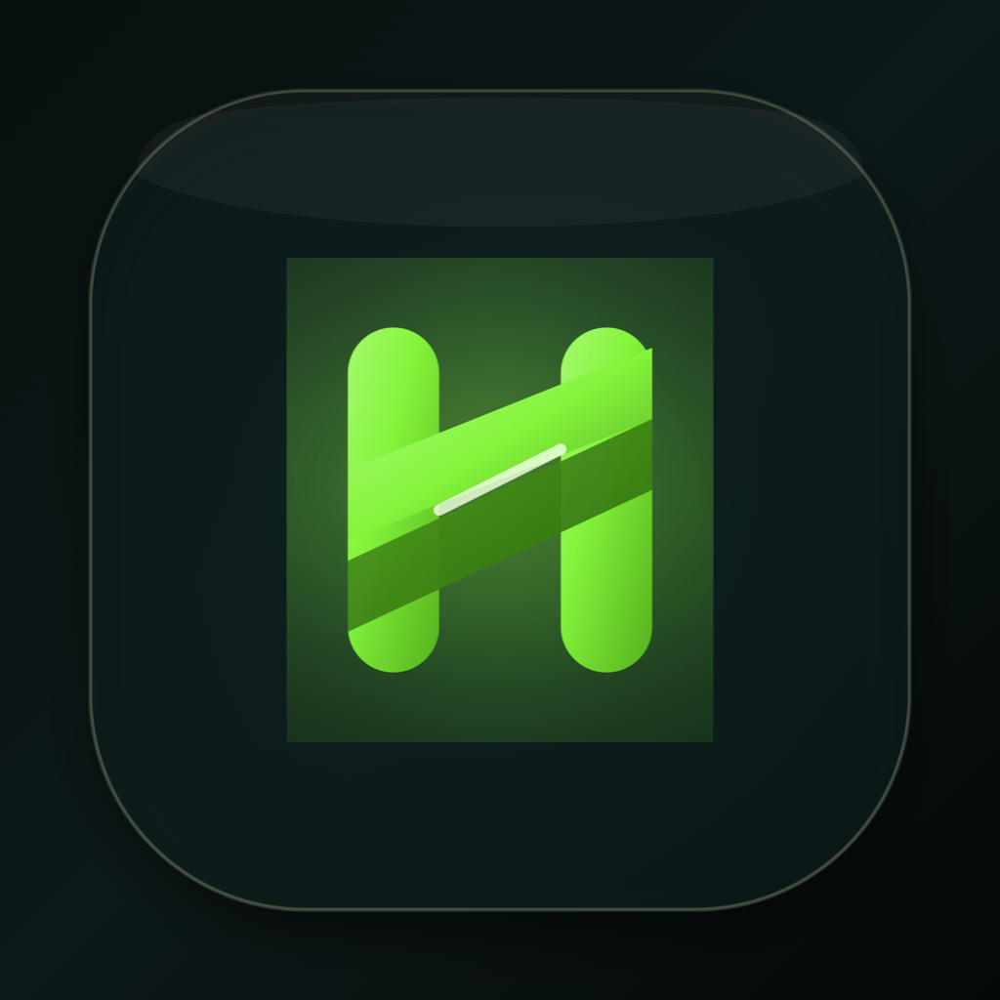
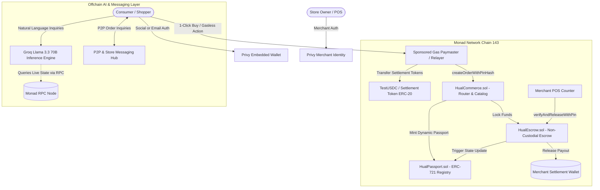
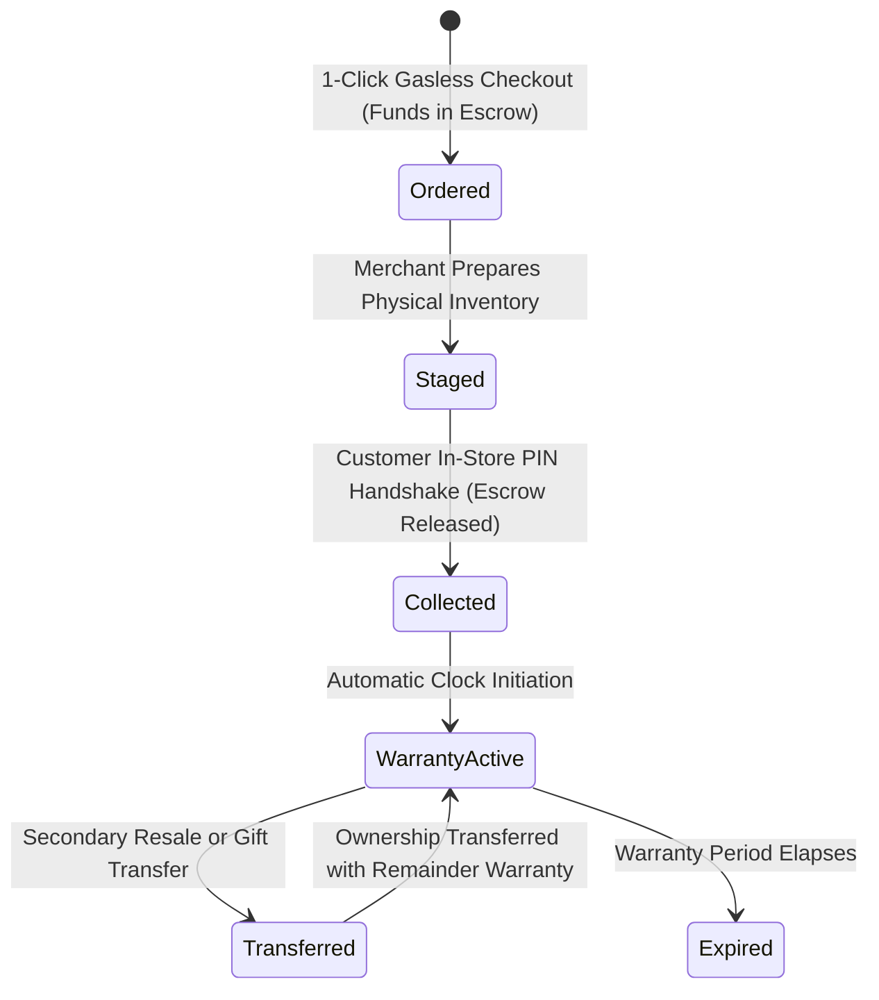

# Haul Protocol

<div align="center">



# The Decentralized High-Throughput Commerce Protocol on Monad

**Products You Can Buy, Own, Verify, and Transfer Onchain.**

[](LICENSE)
[-836EF9.svg)](https://monad.xyz)
[-363636.svg)](https://soliditylang.org/)
[](https://react.dev/)
[](https://privy.io/)
[](https://groq.com/)
[](https://haul-shopping.vercel.app)
[](#ai-agent--tools-disclosure)

*"Paper and screenshot receipts die after checkout. Products are alive."*

[Live dApp](https://haul-shopping.vercel.app) • [Judges Testing Guide](#judges--evaluators-quick-access-guide) • [Architecture](#protocol-architecture) • [Smart Contracts](#deployed-contracts-monad-mainnet) • [Privy Integration](#meaningful-privy-integration-beyond-login) • [GTM Strategy](#go-to-market--user-acquisition-strategy) • [AI Disclosure](#ai-agent--tools-disclosure) • [Quick Start](#quick-start)

</div>

---

## Table of Contents
- [Executive Overview](#executive-overview)
- [The Problem vs. The Haul Solution](#the-problem-vs-the-haul-solution)
- [Why Monad?](#why-monad)
- [Judges & Evaluators Quick Access Guide](#judges--evaluators-quick-access-guide)
- [Protocol Architecture](#protocol-architecture)
- [The Living Product State Machine](#the-living-product-state-machine)
- [Smart Contracts Deep Dive](#smart-contracts-deep-dive)
- [Deployed Contracts (Monad Mainnet)](#deployed-contracts-monad-mainnet)
- [Meaningful Privy Integration (Beyond Login)](#meaningful-privy-integration-beyond-login)
- [Key Features & Ecosystem Modules](#key-features--ecosystem-modules)
- [Go-To-Market & User Acquisition Strategy](#go-to-market--user-acquisition-strategy)
- [Technology Stack](#technology-stack)
- [Repository Structure](#repository-structure)
- [Quick Start & Local Setup](#quick-start--local-setup)
- [Environment Configuration](#environment-configuration)
- [AI Agent & Tools Disclosure](#ai-agent--tools-disclosure)
- [License & Community](#license--community)

---

## Executive Overview

**Haul** is an onchain consumer commerce protocol engineered for high-throughput, zero-friction retail on Monad. It links physical retail merchandise, cryptographic escrow settlement, and perpetual digital ownership by minting an interactive **ERC-721 Living Product Passport** for every purchase.

In traditional retail, commerce terminates at the cash register with a dead paper receipt or a easily forged PDF. When a customer walks away, warranty claims, service histories, serial number authenticity, and secondary resale verification are completely broken.

Haul transforms retail transactions into an immutable onchain state machine:

```text
DISCOVER -> GASLESS BUY -> NON-CUSTODIAL ESCROW -> STAGED -> IN-STORE PIN HANDSHAKE -> ACTIVE PASSPORT -> WARRANTY CLAIMS -> ONCHAIN RESALE TRANSFER
```

With 100% sponsored transaction gas, Privy embedded social login, and sub-second execution on Monad, Haul delivers Web2-native consumer speed with Web3 cryptographic guarantees.

---

## The Problem vs. The Haul Solution

| Challenge in Traditional Commerce | How Haul Solves It Onchain |
| :--- | :--- |
| **$100B+ Payment Chargeback Fraud:** Web2 merchants face friendly fraud, chargebacks, and payment clawbacks up to 90 days post-sale. | **Cryptographic Escrow (`HualEscrow.sol`):** Funds are locked non-custodially on Monad and released instantly only when the customer's secret 4-digit PIN hash (`keccak256`) is verified in person. Zero chargebacks. |
| **Counterfeiting & Fake Receipts:** Paper and digital receipts are easily forged with Photoshop or duplicated across secondary markets. | **Dynamic ERC-721 Product Passports (`HualPassport.sol`):** Products carry verifiable serial numbers, merchant genesis signatures, and immutable timestamps directly in the owner's onchain wallet. |
| **Fragmented Warranty & Service Tracking:** Warranties require paper cards, lost receipts, and slow customer support ticket verification. | **Living Warranty State Engine:** Passports dynamically calculate warranty status and remaining coverage blocks directly from Monad RPC, enabling instant claims. |
| **High Web3 Friction for Mainstream Shoppers:** Asking non-crypto consumers to install extensions, write down seed phrases, and buy gas tokens kills 99% of checkouts. | **Stealth Web3 Architecture:** Powered by Privy embedded social wallets and Haul's onchain Paymaster Relayer, customers check out in 1 click with 0 MON gas fees required. |

---

## Why Monad?

Haul was purpose-built for Monad's parallelized EVM architecture:

1. **Sub-Second Finality:** In-store retail pickups require instant barcode or PIN verification. A customer standing at a physical retail counter cannot wait 15–30 seconds for block confirmations. Monad's sub-second finality delivers point-of-sale confirmation indistinguishable from Apple Pay.
2. **Micro-Cent Gas Sponsorship:** Haul sponsors 100% of customer transaction gas. In traditional chains, sponsoring multiple lifecycle steps (`approve`, `purchase`, `escrowDeposit`, `mintPassport`, `verifyPickupPin`, `releaseEscrow`) would bankrupt a protocol. On Monad, sponsoring 5+ lifecycle operations per purchase costs fractions of a cent.
3. **10,000 TPS Parallel Execution:** Black Friday drops, ticket releases, and simultaneous retail checkouts create severe network spikes. Monad's parallel transaction scheduling prevents network congestion and gas spikes during high-volume consumer drops.

---

## Judges & Evaluators Quick Access Guide

### Live Deployments
- **Live dApp (Frontend):** [https://haul-shopping.vercel.app](https://haul-shopping.vercel.app)
- **Backend API Service:** [https://haul-production-73ba.up.railway.app](https://haul-production-73ba.up.railway.app)
- **GitHub Repository:** [https://github.com/OpeyemiMoses/Haul](https://github.com/OpeyemiMoses/Haul)
- **Target Network:** Monad Mainnet / Devnet (Chain ID: `143`, RPC: `https://rpc.monad.xyz`)

### Zero-Friction Testing (No Wallet Extensions or Faucet Funds Required)
1. Open the Live dApp at [https://haul-shopping.vercel.app](https://haul-shopping.vercel.app).
2. Click **"Sign In"** in the top navigation bar.
3. Log in with **1 click using Google, Twitter, or Email** via our integrated Privy embedded wallet (MetaMask and external wallets are also supported).
4. **All transaction gas is 100% sponsored** by Haul's onchain Paymaster & Relayer. Judges do not need $MON tokens or faucet funds to test checkouts, escrow releases, or passport updates.

### Recommended 3-Minute Testing Walkthrough

1. **Gasless Checkout & Escrow Locking**
   - Navigate to the **"Marketplace"** tab or select any featured luxury item (e.g., *iPhone 16 Pro Max*, *Aurora Pro Studio Headset*, or *Cyber Tech Windrunner Jacket*).
   - Click **"Buy Now"** (or add items to cart and click **"Checkout"**).
   - Confirm the transaction: Notice that **no gas popups or token fees are required**.
   - Funds are locked into `HualEscrow.sol` on Monad, and a dynamic 4-digit cryptographic pickup PIN (e.g., `8421`) and encrypted QR pass are generated.

2. **Inspect the Living ERC-721 Product Passport**
   - Click **"Passports"** in the navigation bar.
   - View your newly minted onchain Living Product Passport.
   - Review the immutable serial number, original merchant, active warranty timeline, and state machine status (`Ordered` / `ReadyForPickup`).

3. **Complete the In-Store Cryptographic Handshake (Merchant POS)**
   - Navigate to the **"Merchant"** section or click **"Merchant Counter"**.
   - Select the active order and enter the customer's **4-digit pickup PIN**.
   - The smart contract verifies the `keccak256` hash onchain, releases the escrow payment to the merchant, and transitions the passport state to **`Collected`** & **`WarrantyActive`**.

4. **Test the AI Account Concierge (Groq Llama 3.3 70B)**
   - Click the circular floating AI Assistant button in the bottom-right corner.
   - Ask questions regarding your account or orders, such as:
     - *"What is my pickup PIN?"*
     - *"Can I see my warranty coverage?"*
     - *"How does escrow protection work on Haul?"*
   - The AI queries live Monad contract and wallet state to return direct answers and interactive order cards.

5. **Explore Verified Stores & Messaging**
   - Visit the **"Stores"** page to inspect verified boutique retailers (verified automatically upon listing 1 catalog item).
   - Open the **"Inbox"** to test direct messaging threads between customers and store owners.

---

## Protocol Architecture



---

## The Living Product State Machine

Unlike static NFT art, every `HualPassport` token implements a dynamic 5-stage onchain state machine:



1. **`Ordered` (0):** Order created, funds deposited into `HualEscrow.sol`, pickup PIN hashed (`keccak256`) and stored onchain.
2. **`ReadyForPickup / Staged` (1):** Merchant packages physical merchandise and marks item ready for collection.
3. **`Collected` (2):** Customer presents 4-digit PIN or QR pass at the store counter. Merchant submits PIN, smart contract verifies hash, escrow funds release instantly to merchant, and passport advances.
4. **`WarrantyActive` (3):** The manufacturer/store warranty clock begins ticking onchain. Warranty claims can be submitted directly against the passport token ID.
5. **`Transferred` (4):** When the physical item is sold or gifted, the passport is transferred onchain. Secondary buyers inherit verifiable serial history and the remaining active warranty coverage.

---

## Smart Contracts Deep Dive

All smart contracts are written in Solidity `^0.8.24` (Cancun EVM compatible) with strict OpenZeppelin standards:

### 1. `HualPassport.sol` (Dynamic ERC-721 Living Product Passport)
- **Token Standard:** ERC-721 with dynamic metadata and onchain state tracking.
- **Core State Stored:**
  - `serialNumber`: Unique physical device/apparel serial fingerprint.
  - `merchant`: Original verified brand or boutique wallet address.
  - `purchaseTimestamp`: Immutable block timestamp of order creation.
  - `warrantyDuration`: Duration of factory coverage (in seconds/blocks).
  - `currentState`: Enum (`Ordered`, `ReadyForPickup`, `Collected`, `WarrantyActive`, `Transferred`).
- **Key Methods:**
  - `mintPassport(address to, string serial, uint256 warrantySecs, uint256 orderId)`: Authorized minting called by `HualCommerce`.
  - `updatePassportState(uint256 tokenId, uint8 newState)`: Updates state progression following verification handshakes.
  - `transferOwnershipWithWarranty(...)`: Ensures warranty metadata remains tethered to the physical item across transfers.

### 2. `HualEscrow.sol` (Cryptographic Non-Custodial Escrow)
- **Security Invariant:** Escrowed funds are strictly non-custodial and can only be released upon matching the cryptographic PIN hash (`keccak256(bytes(pin))`) or explicit order cancellation before collection.
- **Key Methods:**
  - `deposit(uint256 orderId, address buyer, address merchant, uint256 amount, bytes32 pinHash)`: Locks settlement tokens and registers PIN hash.
  - `release(uint256 orderId, string memory pin)`: Validates `keccak256(abi.encodePacked(pin)) == order.pinHash`. Transmits funds to merchant and notifies `HualPassport`.
  - `refund(uint256 orderId)`: Allows buyer refund if order is cancelled before merchant staging.

### 3. `HualCommerce.sol` (Protocol Coordinator & Catalog Registry)
- Coordinates inventory levels, product catalog entries, merchant store profiles, and checkout routing.
- Validates merchant store verification passes (awarding the official Verified Store Pass upon active listing of catalog items).
- Integrates with the Gas Paymaster to facilitate gasless transactions.

### 4. `TestUSDC.sol` (Settlement Token)
- ERC-20 settlement token with 6 decimals mirroring production Circle USDC on Monad.

---

## Deployed Contracts (Monad Mainnet)

Haul is deployed and operating live on **Monad Mainnet** (Chain ID: `143`).

| Contract Name | Monad Explorer Link & Address | Purpose |
| :--- | :--- | :--- |
| **HualPassport (ERC-721)** | [`0xb56BDf7C9EC3B265A4e531FDD297771f60354d6A`](https://monadexplorer.com/address/0xb56BDf7C9EC3B265A4e531FDD297771f60354d6A) | Dynamic Living Product Passport & provenance registry |
| **HualEscrow** | [`0xE6f09EfEEA37F4c5D94f299c8DAf8f9E99A3989e`](https://monadexplorer.com/address/0xE6f09EfEEA37F4c5D94f299c8DAf8f9E99A3989e) | Cryptographic in-store PIN handshake & escrow lock |
| **HualCommerce** | [`0x021b27596a0496a8e3cd1306b89EfbDaD85B692E`](https://monadexplorer.com/address/0x021b27596a0496a8e3cd1306b89EfbDaD85B692E) | Catalog coordinator, store verification & checkout router |
| **Official USDC** | [`0x754704Bc059F8C67012fEd69BC8A327a5aafb603`](https://monadexplorer.com/address/0x754704Bc059F8C67012fEd69BC8A327a5aafb603) | Circle-issued settlement currency on Monad |
| **Sponsored Gas Paymaster** | `0xb4825ABd70312e52083DDB55D3a00c0c309a6C09` | Sponsored relayer funding 100% of user checkout gas |

---

## Meaningful Privy Integration (Beyond Login)

Haul does not treat Privy as a simple OAuth login button. Privy’s embedded wallet architecture is woven into the protocol's core execution flow:

1. **Non-Custodial Key Infrastructure for Invisible Gasless Commerce:** Every user authenticated via Google, Twitter, or email receives an embedded Monad wallet. Haul binds this embedded address as the buyer identity in `HualCommerce.sol` and `HualEscrow.sol`. Paired with our onchain Gas Paymaster, buyers execute checkouts without needing $MON or signing hexadecimal transactions.
2. **Onchain Custody of Living ERC-721 Product Passports:** Newly minted passports are delivered directly to the user's Privy embedded wallet. Mainstream shoppers hold verifiable proof of ownership, access warranty claims, and execute secondary resale transfers without ever downloading a browser extension.
3. **Merchant Point-of-Sale Verification:** Boutique retailers register onchain storefronts tied directly to their Privy wallet. In-store fulfillment actions and cryptographic PIN releases are validated against the merchant mapping stored in the smart contracts.
4. **Wallet-Linked P2P & Merchant Messaging:** The customer-merchant messaging hub utilizes the user's Privy embedded address as their cryptographic identity. Discussions, receipts, and order context attachments are cryptographically tied to the active wallet state.

---

## Key Features & Ecosystem Modules

### 1. Dynamic Living 3D Product Passports
- Interactive 3D/glassmorphic passport cards showcasing real-time onchain specs, serial numbers, and warranty progress bars.
- Live onchain querying directly from Monad RPC (zero mocked data).

### 2. Cryptographic In-Store Pickup Handshake
- Deterministic 4-digit secret PIN generated upon payment and hashed via `keccak256`.
- Merchant scans or inputs the PIN at the physical counter to trigger instant escrow release.

### 3. Dedicated Stores Directory & Verification Pass
- Dedicated **Stores** navigation directory for browsing verified boutique retailers.
- **Verification Rule:** Stores earn the official Verified Store Pass once at least 1 authenticated item is actively listed in their catalog.

### 4. Decentralized Store Manager & POS Counter
- Store owners configure business hours, physical pickup addresses, banner themes, and contact metadata.
- Integrated Point of Sale (POS) counter for staging orders and confirming customer PIN pickups.

### 5. AI Account Concierge (Groq Llama 3.3 70B)
- Embedded floating AI assistant powered by Groq's high-speed inference engine.
- **Account Reasoning:** Knows all pending, received, escrowed, and transferred orders associated with your wallet.
- **Interactive Disambiguation:** When asking for pickup PINs or tracking codes without specifying an order, the AI presents clickable order cards to select the exact item.

### 6. Peer-to-Peer & Merchant Messaging Hub
- Direct messaging between buyers and store owners with order context badges.

### 7. Apple-Glass Design Engine & 3-Mode Theme System
- Built with a custom Vanilla CSS Apple Glassmorphic design system.
- Full 3-mode theme system: System default (synchronizes with OS appearance), Light Mode, and Dark Mode.
- Horizontally scrollable touch tracks on mobile for brand badges, hero pillars, and 3D model showcases.

---

## Go-To-Market & User Acquisition Strategy

### 1. Beachhead Market: High-Value & Collectible Physical Goods
Targeting sectors where receipt forgery and warranty disputes are most painful:
- **Streetwear & Limited Drops:** Sneakers and designer apparel plagued by fake StockX receipts.
- **Consumer Electronics & Spatial Tech:** Hardware where serial numbers and warranty coverage determine resale value.
- **Luxury Timepieces & Designer Goods:** Products traded multiple times across their lifespans.

### 2. Two-Sided Acquisition Flywheel
- **Supply Engine (Merchants):** Zero-barrier onboarding (storefront live in 3 minutes), elimination of payment chargebacks via smart contract escrow, and perpetual secondary resale royalties programmed into passport metadata.
- **Demand Engine (Consumers):** 1-click social checkout with zero gas fees. The in-store pickup moment turns offline retail shoppers directly into onchain passport holders.
- **Viral Resale Referral Loop:** When an owner resells an item months later, the buyer insists on verifying the living passport on Haul to prove authenticity. This forces secondary buyers onto Haul with near-zero Customer Acquisition Cost (CAC).

---

## Technology Stack

| Layer | Technologies |
| :--- | :--- |
| **Blockchain** | Monad Mainnet / Devnet, EVM Cancun, Solidity `^0.8.24` |
| **Smart Contract Tooling** | Hardhat, Ethers.js v6, OpenZeppelin Contracts |
| **Frontend Framework** | React 19, Vite, Vanilla CSS Design System |
| **Authentication & Embedded Wallets** | Privy Embedded Wallets (`@privy-io/react-auth`), Viem, Wagmi |
| **AI Inference Engine** | Groq SDK (`llama-3.3-70b-versatile`) |
| **Design & UI Architecture** | VisionOS / Sonoma Liquid Glass, Lucide React |
| **Hosting & Infrastructure** | Vercel (Frontend dApp), Railway (Backend Relayer / API) |

---

## Repository Structure

```text
Haul/
├── contracts/                  # Solidity smart contracts & Hardhat suite
│   ├── contracts/
│   │   ├── HualPassport.sol    # Dynamic ERC-721 living product passport
│   │   ├── HualEscrow.sol      # Cryptographic escrow lock & PIN verification
│   │   ├── HualCommerce.sol    # Protocol coordinator, catalog & store registry
│   │   └── TestUSDC.sol        # Test settlement token
│   ├── scripts/
│   │   ├── deployProtocol.js   # Automated deployment & seeding script
│   │   └── testDiag.js         # Monad testnet diagnostic suite
│   ├── test/                   # Hardhat unit tests (100% passing)
│   └── hardhat.config.js
│
├── frontend/                   # Modern React 19 dApp
│   ├── public/
│   │   └── assets/             # High-res branding, 3D renders, and icons
│   ├── src/
│   │   ├── components/         # Glassmorphic UI components
│   │   │   ├── LandingPage.jsx       # VisionOS hero, trusted vendors & showcase
│   │   │   ├── LiquidGlassShowcase.jsx # Mobile-swipeable 3D product showcase
│   │   │   ├── Marketplace.jsx       # General catalog and product detail
│   │   │   ├── StoresPage.jsx        # Verified stores directory
│   │   │   ├── MerchantDashboard.jsx # POS counter & PIN fulfillment
│   │   │   ├── AISupportModal.jsx    # Groq AI order reasoning concierge
│   │   │   ├── InboxPage.jsx         # Customer & merchant messaging hub
│   │   │   ├── SettingsPage.jsx      # System, Light, and Dark mode switch
│   │   │   └── PassportCard.jsx      # Living Product Passport 3D card
│   │   ├── contracts/          # Contract ABIs & deployed addresses
│   │   ├── lib/
│   │   │   ├── groqClient.js         # Groq AI reasoning engine
│   │   │   ├── messageRegistry.js    # P2P and merchant message store
│   │   │   └── web3.js               # Ethers / Monad testnet interaction layer
│   │   └── index.css                 # Apple-glass luxury design system
│   └── package.json
│
├── .github/                    # Community standards & workflows
├── CONTRIBUTING.md             # Contribution guidelines
├── LICENSE                     # MIT License
├── README.md                   # Complete protocol documentation
└── SECURITY.md                 # Security disclosure policy
```

---

## Quick Start & Local Setup

### 1. Prerequisites
- **Node.js**: v18.0.0 or higher
- **npm** or **yarn**
- Free API Key from [Groq Console](https://console.groq.com)
- Free Privy App ID from [Privy Dashboard](https://dashboard.privy.io)

### 2. Clone the Repository
```bash
git clone https://github.com/OpeyemiMoses/Haul.git
cd Haul
```

### 3. Setup & Run Frontend
```bash
cd frontend
cp .env.example .env
npm install
npm run dev
```
Open `http://localhost:5173` in your browser.

### 4. Smart Contracts Testing
```bash
cd ../contracts
cp .env.example .env
npm install

# Run the complete unit test suite
npx hardhat test

# Deploy to Monad Network
npx hardhat run scripts/deployProtocol.js --network monadTestnet
```

---

## Environment Configuration

### Frontend (`frontend/.env`)
```env
# Privy Application ID (from https://dashboard.privy.io)
VITE_PRIVY_APP_ID=your_privy_app_id

# Monad Network RPC (Chain ID 143)
VITE_MONAD_RPC_URL=https://rpc.monad.xyz
VITE_MONAD_CHAIN_ID=143

# Sponsored Gas Paymaster / Relayer
VITE_SPONSORED_PAYMASTER_KEY=0x...
VITE_SPONSORED_PAYMASTER_ADDR=0x...

# Groq AI Inference Key (from https://console.groq.com)
VITE_GROQ_API_KEY=gsk_...
```

### Contracts (`contracts/.env`)
```env
MONAD_RPC_URL=https://rpc.monad.xyz
CHAIN_ID=143
PRIVATE_KEY=your_deployer_private_key
```

---

## AI Agent & Tools Disclosure

In accordance with hackathon rules and guidelines regarding transparency in AI-assisted software engineering, this section details the AI tools and agentic workflows utilized during the development of Haul.

### 1. Primary AI Tools & Systems Used

- **Antigravity IDE (Google DeepMind)**: Served as an autonomous AI coding agent and pair programmer for codebase implementation, architectural scaffolding, UI refinement, and continuous integration validation.
- **Groq Llama 3.3 70B Versatile / Llama 3.1 8B**: Integrated into the live production dApp as the runtime intelligence layer powering Haul's AI Shopping & Support Companion (`AISupportModal`, order status lookup, dispute triage, and passport verification).

### 2. Attribution & Division of Responsibility

| Component & Phase | Human Direction & Architecture | AI Agent Contribution & Scaffolding |
| :--- | :--- | :--- |
| **Protocol Design & State Machine** | Formulated the core concept of replacing disposable receipts with living onchain Product Passports (ERC-721); designed the 4-digit PIN hash cryptographic handshake (`keccak256`) for in-store pickup and non-custodial escrow release. | Generated initial Solidity contract stubs, formatted architectural state flow diagrams, and structured lifecycle enum definitions. |
| **Smart Contract Engineering** | Specified escrow settlement logic, invariant checks, reentrancy guards, token minting access controls, and Monad Cancun EVM compatibility. | Assisted in writing unit test suites (`contracts/test/`), deployment automation scripts (`scripts/deployProtocol.js`), and gas optimization benchmarks. |
| **Frontend & Design System** | Created the visual brand identity, dark obsidian aesthetic, Apple Liquid Glass dock styling, color tokens, and responsive layout hierarchy. | Implemented React components, CSS transition classes, modal portal integration, mobile drawer adaptations, and form validation handlers. |
| **Privy & Gasless Web3 Architecture** | Designed the gasless consumer onboarding flow, sponsored Paymaster relayer strategy, and embedded wallet lifecycle hooks to eliminate visitor seed phrase requirements. | Integrated `@privy-io/react-auth` SDK methods, context state synchronization in `AuthContext.jsx`, and fallback handling. |
| **Auditing & Verification** | Reviewed 100% of contract logic, cryptographic signature verifications, payment math, and deployment keys; conducted end-to-end checkout and pickup testing on Monad RPC. | Executed automated test runners (`npx hardhat test`), production bundle compilations (`vite build`), and lint verification. |

### 3. Human Oversight & Code Integrity

Every line of smart contract code, cryptographic verification routine, and financial logic was audited, tested, and validated by the team prior to deployment. The AI agent served as an efficiency multiplier, accelerating repetitive boilerplate, UI styling, and documentation structuring while architectural authority and protocol decisions remained entirely human-directed.

---

## License & Community

This project is licensed under the **MIT License** - see the [LICENSE](LICENSE) file for details.

- **[Contributing Guidelines](CONTRIBUTING.md)**: How to submit issues and PRs.
- **[Security Policy](SECURITY.md)**: Protocol vulnerability disclosures.

<div align="center">

**Built for the Monad Metropolis Hackathon**  
*Physical Luxury. Verifiable Onchain. Sub-Second Speed.*

</div>
